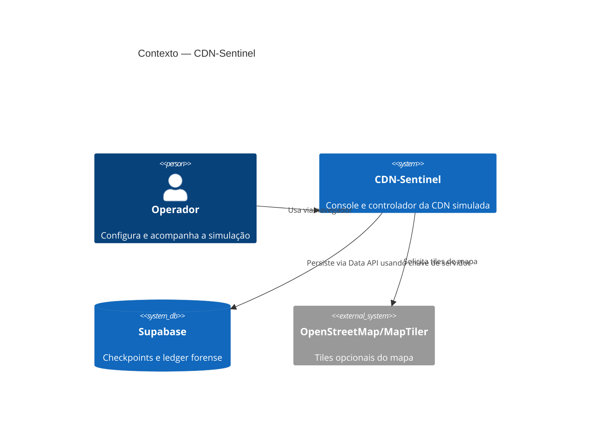
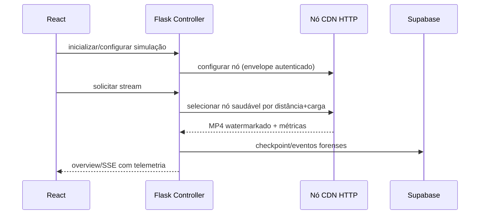
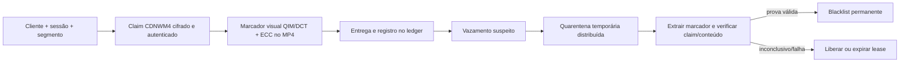

# CDN-Sentinel

Simulador acadêmico de uma CDN de vídeo distribuída com control plane observável, roteamento geográfico, failover, watermark forense e resposta coordenada a vazamentos. O objetivo não é reproduzir uma CDN de produção: capacidade, custo e demanda são modelos didáticos; as requisições HTTP, os processos de nó e a investigação de mídia são reais no ambiente local.

## Sumário

- [Integrantes do grupo](#1-integrantes-do-grupo)
- [Resumo e objetivos](#2-resumo-e-objetivos)
- [Conceitos utilizados](#3-conceitos-utilizados)
- [Arquitetura: C4, ADRs e padrões](#4-arquitetura-c4-adrs-e-padrões)
- [Stack tecnológico](#5-stack-tecnológico)
- [Requisitos](#6-requisitos)
- [Compilação e execução](#7-compilação-e-execução)
- [Dockerização](#8-dockerização)
- [Fluxos do programa](#9-fluxos-do-programa)
- [Pipeline de watermark](#10-pipeline-de-watermark)
- [Figuras do programa](#11-figuras-do-programa)
- [Estrutura do projeto](#12-estrutura-do-projeto)
- [Testes, auditoria e limitações](#13-testes-auditoria-e-limitações)
- [Ferramentas de IA utilizadas](#14-ferramentas-de-ia-utilizadas)

## 1. Integrantes do grupo

| Nome | Matrícula | Contribuição |
|---|---|---|
| Luis Reis | _a informar antes da entrega_ | Implementação e integração da simulação, frontend, infraestrutura, testes e documentação. |

> A matrícula não está presente em nenhum arquivo versionado do projeto e não foi inventada. Complete esse campo antes da submissão acadêmica.

## 2. Resumo e objetivos

O CDN-Sentinel inicia nós HTTP locais e clientes virtuais, seleciona o melhor nó disponível pela distância e carga, mede as entregas e exibe a operação em um console React. Cada entrega recebe uma prova de watermark forense; um vazamento suspeito entra imediatamente em quarentena temporária distribuída enquanto a análise verifica marca, claim autenticado e conteúdo. Havendo prova válida, a blacklist permanente é propagada; sem confirmação, a quarentena expira ou é liberada.

Os objetivos são:

- demonstrar comunicação, observabilidade e falhas em uma topologia distribuída simulada;
- comparar demanda virtual com telemetria HTTP observada sem misturar tarefas internas forenses no SLO do cliente;
- atribuir mídia vazada a uma sessão de forma autenticada e auditável;
- permitir experimentar decisões de capacidade, cache, balanceamento, preço e campanha no modo de gestão;
- persistir checkpoints, históricos e ledger forense no Supabase com acesso somente de servidor.

## 3. Conceitos utilizados

| Área | Aplicação no projeto |
|---|---|
| Sistemas distribuídos | nós HTTP independentes, hierarquia origin/regional/edge, gossip com ACK, deduplicação, retry, failover e leases de quarentena. |
| Observabilidade | métricas de fila, RTT, E2E, p50/p95/p99, erros, eventos, correlação por `request_id`/`trace_id` e SSE. |
| Balanceamento | seleção `nearest-healthy`, `least-utilized` ou híbrida; o modo orquestração combina distância, saúde e pressão de carga. |
| Segurança de transporte | envelopes AES-256-GCM, HMAC, nonce, timestamp e TTL para mensagens internas. |
| Watermark forense | QIM/DCT visual, código ECC, claim AES-GCM/HMAC/HKDF, associação de marcador a sessão e cadeia HMAC de eventos. |
| Defesa contra pirataria | quarentena temporária com expiração/reassignação, análise de evidência real e blacklist idempotente. |
| Persistência | Supabase/PostgREST com RLS para estado do controlador, histórico, claims, marcadores, sessões A/B e eventos forenses. |

## 4. Arquitetura: C4, ADRs e padrões

O contexto e os contêineres C4, as decisões arquiteturais e os padrões estão detalhados em [docs/arquitetura-e-decisoes.md](docs/arquitetura-e-decisoes.md).



Padrões centrais: controlador-orquestrador, repositório com snapshot isolado, workers com ciclo de vida explícito, ledger append-only verificável, fallback de persistência e clientes virtuais para escalar a demonstração sem criar milhares de processos.

## 5. Stack tecnológico

- Backend: Python 3.12, Flask, Flask-RESTX, Flask-CORS, Requests.
- Mídia e watermark: FFmpeg/FFprobe, Pillow, NumPy, SciPy, Cryptography e scikit-video.
- Frontend: React 18, TypeScript, Vite, Leaflet, Recharts e Lucide.
- Persistência: Supabase Data API/PostgreSQL; SQLite somente como fallback forense local quando a API não está disponível.
- Entrega: Docker Compose, Nginx e Make (WSL/Linux).

## 6. Requisitos

- Python 3.12 e `pip`.
- Node.js 20 e npm.
- FFmpeg e FFprobe disponíveis no `PATH` para watermark e testes de vídeo.
- Para Docker: Docker Engine/Desktop com Compose v2.
- Para Supabase: `SUPABASE_URL` e `SUPABASE_SECRET_KEY` de servidor válidos. Não use a chave publicável no backend e nunca publique segredos `VITE_*`.

Copie `.env.example` para `.env` e preencha somente as variáveis necessárias ao ambiente.

No WSL/Ubuntu:

```bash
sudo apt update
sudo apt install -y python3 python3-venv python3-pip ffmpeg make curl
# Instale Node 20 e habilite a integração WSL do Docker Desktop, se usar Docker.
```

## 7. Compilação e execução

### 7.1. Desenvolvimento local

```bash
python3 -m venv .venv
source .venv/bin/activate
python -m pip install -r requirements.txt
cd frontend && npm ci && cd ..
python app.py
```

Em outro terminal:

```bash
cd frontend
npm run dev
```

Abra `http://127.0.0.1:5173`; o Vite encaminha `/api` para o Flask em `http://127.0.0.1:5000`. Swagger fica em `http://127.0.0.1:5000/docs`.

No WSL, os atalhos equivalentes são:

```bash
make install
make dev
```

`make dev` encerra apenas os dois processos que ele próprio iniciou. Os demais alvos estão em [docs/desenvolvimento-e-testes.md](docs/desenvolvimento-e-testes.md).

### 7.2. Supabase

As tabelas são definidas em `supabase/migrations/20261114000000_cdn_sentinel.sql`. Depois de autenticar a CLI e vincular o projeto:

```bash
supabase link --project-ref <project-ref>
supabase db push --include-all
supabase migration list
```

O endpoint de status expõe `storage.backend`, `storage.durable` e `storage.reason`. Se a credencial ou a API falhar, a simulação continua com o fallback local e informa o motivo; isso não deve ser confundido com persistência durável. Veja [docs/supabase-e-operacao.md](docs/supabase-e-operacao.md).

## 8. Dockerização

O backend é construído sobre `python:3.12-slim`, instala FFmpeg, roda como usuário não privilegiado e usa `init: true` no Compose para reaproveitar corretamente processos filhos de nós/clientes. O frontend é um build multiestágio Node 20 servido por Nginx e faz proxy de `/api` e do SSE ao backend. O diretório de runtime não é volume Docker: a persistência de produção é o Supabase e o fallback local é deliberadamente efêmero.

```bash
docker compose up --build
# ou
make docker-up
```

Serviços: console em `http://127.0.0.1:8080`, API em `http://127.0.0.1:5000` e health em `/health`. O Compose repassa `SUPABASE_URL` e `SUPABASE_SECRET_KEY` do `.env` apenas ao backend; a chave não chega ao bundle do frontend.

Validações previstas:

```bash
make docker-config
make docker-build
make docker-test
make docker-smoke
```

`docker-test` executa a suíte Python dentro da imagem backend. `docker-smoke` sobe o stack, valida health, rota de watermark, proxy Nginx e encerra os contêineres. A situação da execução local desta auditoria está registrada em [docs/auditoria-tecnica.md](docs/auditoria-tecnica.md).

## 9. Fluxos do programa



O fluxo completo de orquestração, failover, quarentena e gamificação está em [docs/orquestracao-cdn.md](docs/orquestracao-cdn.md).

## 10. Pipeline de watermark



A especificação, do payload à verificação e à descriptografia, está em [docs/watermark-forense.md](docs/watermark-forense.md).

## 11. Figuras do programa

O repositório não contém capturas de interface versionadas no momento. Para não apresentar imagens artificiais como execução real, esta documentação mantém apenas os diagramas acima. Antes da entrega, registre capturas reais do Command Center, Network Lab, Security Observatory e Watermark Studio em `docs/imagens/` e inclua-as nesta seção com a configuração usada na simulação.

## 12. Estrutura do projeto

```text
CDN-Sentinel/
├── app.py                     # composição Flask e ciclo de vida
├── node_app.py / client_app.py # processos locais simulados
├── controllers/               # controle e cálculo de telemetria
├── services/                  # streaming, monitor, watermark, Supabase
├── repositories/              # cache transacional e snapshots do controlador
├── management/                # modo econômico/gamificado
├── watermark/ e utils/        # algoritmos, claims, ECC e mídia
├── routes/                    # contratos RESTX
├── frontend/                  # React/TypeScript/Vite/Nginx
├── supabase/migrations/       # esquema versionado do banco
├── tests/                     # unitários, integração e E2E local
├── tools/                     # downloads e benchmarks explícitos
├── docs/                      # documentação aprofundada
└── Dockerfile, docker-compose.yml, Makefile
```

## 13. Testes, auditoria e limitações

```bash
make test
make docker-test
make docker-smoke
```

O projeto separa tráfego de clientes de capturas forenses internas nas métricas de SLO. Os custos, a demanda e a geografia são didáticos; não representam preço, capacidade ou roteamento de uma CDN comercial. A detecção de watermark é experimental e uma investigação inconclusiva não deve atribuir pirataria.

Consulte [docs/desenvolvimento-e-testes.md](docs/desenvolvimento-e-testes.md) e [docs/auditoria-tecnica.md](docs/auditoria-tecnica.md) para comandos, escopo e resultados de validação.

## 14. Ferramentas de IA utilizadas

| Ferramenta | Uso e orientação recebida | Avaliação honesta |
|---|---|---|
| Codex (OpenAI) | Leitura do repositório, análise de inconsistências, implementação, refatoração, testes e redação. Foi orientado por requisitos funcionais, arquivos do projeto, evidências de testes e restrições de segurança. | Acelerou diagnóstico e documentação, mas exigiu revisão humana de métricas, credenciais, dados acadêmicos e comandos. Não substitui validação de mídia, Docker ou segurança. |
| ChatGPT | Auxiliou na análise dos requisitos do projeto, na redação dos prompts e em pesquisar estratégias de segurança e de orquestração da CDN | Acelerou bastante o trabalho de conceituação do projeto, ajudando a definir como seria a estrutura do projeto, mas todo o trabalho de escolha da estrutura final passou por seleção, revisão e refinamento humano |