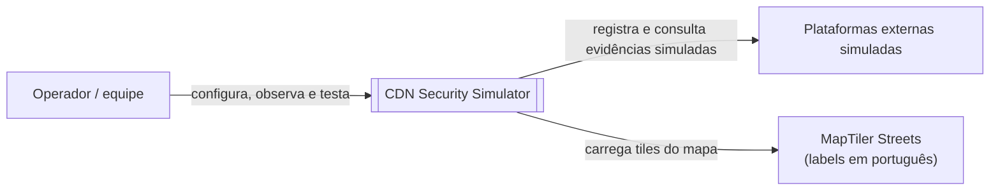
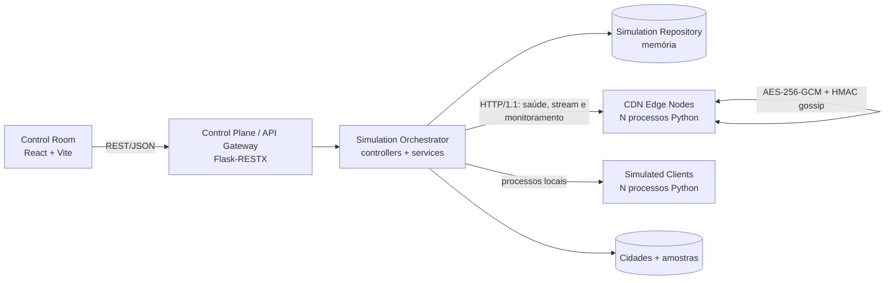

# Arquitetura e diagramas C4

## Escopo da Entrega 2

O sistema é um simulador distribuído de CDN de vídeo. O navegador opera um console React; o control plane Flask coordena a simulação; cada CDN é executada como um processo HTTP independente; clientes simulados são processos separados; e os nós trocam alertas e telemetria por HTTP.

## C4 nível 1 — contexto

O diagrama de contexto identifica o sistema, o operador e as integrações externas:

Fonte editável: [`c4-context.puml`](./c4-context.puml).

## C4 nível 2 — containers

Fonte editável: [`c4-containers.puml`](./c4-containers.puml).

## Decisões visíveis no código

- O controller não acessa diretamente a memória dos nós: usa `CDNHttpClient` para saúde, configuração, streaming e blacklist.
- `TopologyService` e `choose_server` implementam descoberta/routing por proximidade geográfica entre nós saudáveis.
- `ApiController.overview()` funciona como composição de dados para o frontend.
- Cada leitura do status registra uma amostra bounded em `SimulationState.metrics_history`; o overview e o histórico arquivado expõem essa série para os gráficos de blacklist, tráfego por servidor, latência e saúde da CDN.
- `node_app.py` mantém o estado local do nó e propaga `BLACKLIST_ALERT` por gossip HTTP.
- O estado do protótipo é deliberadamente em memória; persistência externa fica como trade-off documentado para a Entrega 3.
