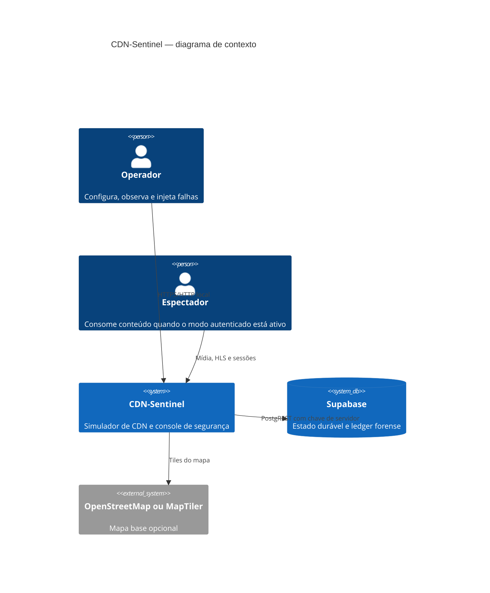
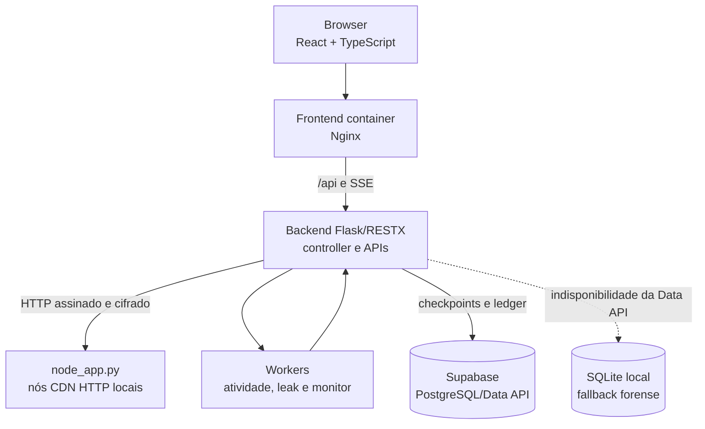

# Arquitetura, C4, ADRs e padrões

Este documento descreve o que está implementado no repositório. A topologia de negócios é simulada; a comunicação entre controller e nós HTTP locais, a geração de mídia e a investigação forense usam processos e arquivos reais.

## C4 — contexto

## C4 — contêineres

## Componentes e responsabilidades

| Camada | Componentes | Responsabilidade |
|---|---|---|
| Apresentação | `frontend/src`, Nginx | Dashboard, mapa, páginas de segurança/gestão, SSE e proxy reverso. |
| API e composição | `app.py`, `routes/api.py`, `controllers/` | Ciclo de vida, validação dos contratos e cálculo de status. |
| Domínio da CDN | `services/stream_service.py`, `services/cdn_http_client.py`, `node_app.py` | Seleção de nó, entrega, failover, telemetria e protocolos internos. |
| Segurança | `services/blacklist_service.py`, `services/monitor_service.py`, `services/watermark_*`, `watermark/`, `utils/crypto.py` | Quarentena, blacklist, investigação, claims, marca visual e criptografia. |
| Persistência | `repositories/in_memory.py`, `services/supabase_store.py`, `services/watermark_registry.py` | Cache concorrente do processo, checkpoints e ledger durável. |
| Gestão | `management/`, `services/catalog_service.py` | Simulador econômico e carga didática de metadados. |

## Decisões arquiteturais (ADRs)

| ADR | Decisão | Consequência |
|---|---|---|
| ADR-001 | O Flask mantém o control plane central; cada nó CDN possui processo e estado local. | Facilita a demonstração de falhas e gossip sem exigir infraestrutura distribuída externa. |
| ADR-002 | Mensagens internas exigem envelope AES-256-GCM, HMAC, nonce e TTL. | Nó rejeita replay, payload sem autenticação e mensagens fora da janela temporal. |
| ADR-003 | A mídia contém marcador visual; o claim autenticado permanece no ledger. | O MP4 público não expõe o token de atribuição em cabeçalho ou prefixo. |
| ADR-004 | Suspeita cria quarentena temporária distribuída antes de haver veredito. | Evita novas entregas ao suspeito; lease expira ou troca de responsável se o nó de análise cair. |
| ADR-005 | Supabase é o armazenamento durável de checkpoints, históricos e provas. | A aplicação usa chave secreta apenas no backend; RLS nega acesso a `anon` e `authenticated`. SQLite é contingência local. |
| ADR-006 | Clientes e nós acima dos limites de processo são virtuais. | Permite testar até 100.000 clientes sem confundir contagem simulada com requisições HTTP reais. |

## Padrões arquiteturais

- **Controller/orchestrator:** `SimulationController` coordena topologia, processos e telemetria; `ApiController` integra serviços para as rotas.
- **Repository com cópia defensiva:** `SimulationRepository.snapshot()` evita que consumidores alterem o estado vivo; mutations passam por métodos controlados ou serviços de domínio.
- **Worker por responsabilidade:** atividade de clientes, criação de leak e monitor rodam em threads próprias, com `stop` e intervalos configuráveis.
- **Lease/heartbeat:** a quarentena possui `expires_at`, `owner_server_id` e redistribuição caso o responsável não esteja saudável.
- **Ledger verificável:** eventos forenses encadeiam hashes HMAC; claims e sessões A/B são validados quando lidos.
- **Ports and adapters leve:** `SupabaseStore` encapsula PostgREST; `SupabaseLedgerBackend` atende o registry sem acoplar algoritmos de watermark à API HTTP.

## Limites intencionais

- O controller não tenta restaurar processos de nó após reinício a partir do checkpoint: o banco preserva estado/auditoria, mas processos e sockets precisam ser reinicializados explicitamente.
- O `MetadataCatalog` é uma carga de simulação para a ação de otimização; não representa um segundo banco de dados.
- Geolocalização, custo, capacidade e demanda são valores pedagógicos, não medições de um provedor de CDN.
