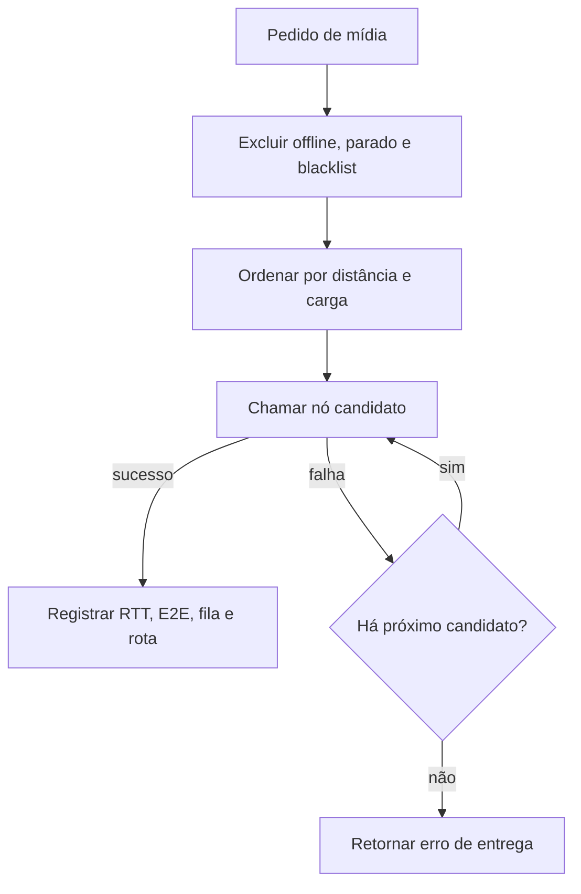
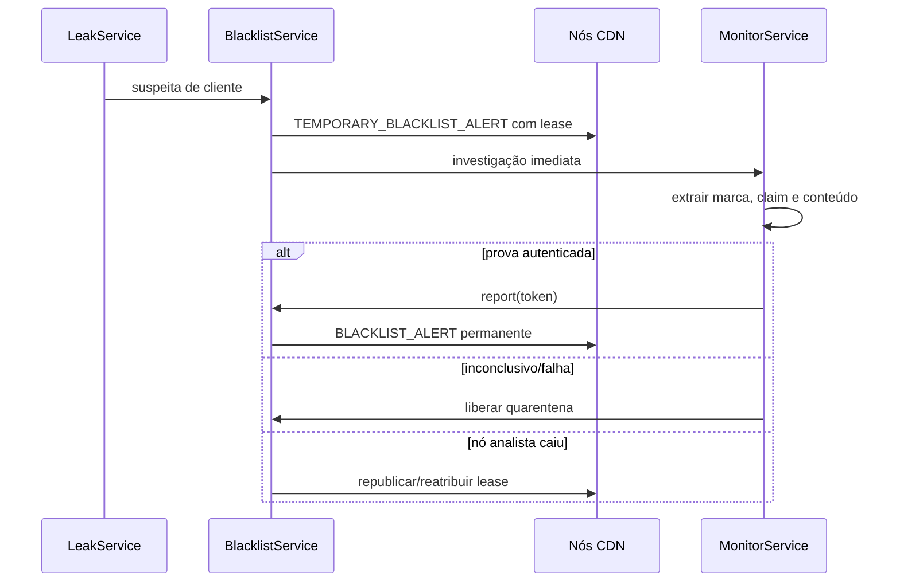

# Orquestração da CDN e resposta a incidentes

## Inicialização e escala

`SimulationController.initialize()` valida `SimulationConfig`, monta servidores e clientes por `TopologyService`, inicia a quantidade permitida de processos HTTP e registra os demais como virtuais. Os limites padrão são controlados por `CDN_REAL_NODE_LIMIT` e `CDN_REAL_CLIENT_LIMIT`; o estado completo preserva totais e uma amostra limitada é enviada ao mapa.

O backend calcula demanda virtual como `clientes_ativos × demand_rps_per_client`. Essa demanda atualiza pressão, fila didática e utilização dos servidores. Requisições HTTP reais são medidas separadamente por cada nó.

## Escolha de nó e failover

`nearest-healthy` prioriza nós saudáveis e próximos. As opções `least-utilized` e `hybrid-latency-capacity` ficam disponíveis na ação de gestão; a decisão preserva saúde e carga, em vez de selecionar apenas o ponto geográfico mais próximo.

## Métricas e SLO

- **Utilização** = demanda virtual / capacidade disponível; é um indicador de pressão, não de experiência do cliente.
- **p50/p95/p99, RTT, E2E e erros** vêm apenas de entregas de clientes na janela observada.
- **Capturas forenses** recebem a marca, mas são sinalizadas como `forensic_capture` e excluídas do SLO, de feedback, do contador de vídeos e das linhas de tráfego do dashboard.
- **Saúde** combina disponibilidade de nós, pressão, latência p95 e taxa de sucesso. Assim, baixa utilização pode coexistir legitimamente com alerta de latência real; a interface mostra os dois indicadores separados.

## Quarentena temporária e blacklist

Enquanto a quarentena estiver válida, `StreamService` e cada `NodeRepository` recusam novas entregas; somente a captura forense interna autenticada pode solicitar a evidência necessária. O controller reaplica/redistribui a quarentena para nós ativos. Se o lease expirar sem avanço, ele é liberado para não manter um cliente preso indefinidamente. No mapa, clientes em quarentena usam cinza; blacklist permanente usa vermelho.

Uma prova completa — marcador exato, claim CDNWM4 válido e correspondência de conteúdo — permite blacklist automática no simulador. Material candidato, corrompido ou inconclusivo permanece disponível para reanálise e não deve gerar atribuição.

## Modo de gestão

Cada tick de gestão representa um dia simulado. Ações têm investimento, custo recorrente, lead time e cooldown. A campanha publicitária calcula aquisição com uma função limitada pelo porte e pela saúde da CDN, para evitar saltos irreais; o resultado é registrado no estado de gestão. A satisfação é mantida entre 0 e 100 e é decomposta em notas de 0 a 10 no frontend.
