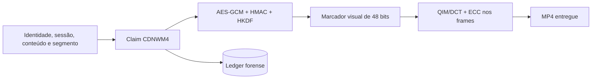

# Watermark forense: emissão, detecção e atribuição

## Objetivo e fronteira de segurança

O marcador visual associa uma entrega a um claim autenticado. O navegador recebe mídia reproduzível, não o token de prova. Chaves de watermark e credenciais de Supabase permanecem no backend.

## Emissão de uma entrega

1. `StreamService` escolhe um nó candidato e cria `request_id`/`trace_id`.
2. O nó emite um claim CDNWM4 contendo identidade do cliente, nó emissor, sessão, conteúdo, segmento, período de validade, algoritmo e `kid`.
3. O claim é cifrado com AES-256-GCM e autenticado com HMAC-SHA256; HKDF deriva material por chave.
4. A marca visual de 48 bits é aplicada aos frames por QIM/DCT, com ECC para tolerar corrupção limitada.
5. `WatermarkRegistry` registra marcador, token, claim e hash. Com Supabase disponível, o `SupabaseLedgerBackend` persiste marcadores, claims, eventos e sessões A/B.
6. O MP4 watermarkado é entregue. `X-Watermark-Token` não é exposto para o consumidor público.

## Detecção e descriptografia

1. A investigação recebe mídia autorizada ou o arquivo de leak simulado.
2. O detector amostra frames a cada dois segundos e preserva o frame final; isso reduz custo sem varrer todos os segundos do vídeo.
3. O detector extrai o marcador visual e consulta o ledger pelo marcador.
4. O claim é autenticado e descriptografado; o hash canônico e os campos de sessão/conteúdo são validados.
5. A comparação de conteúdo confirma que a mídia corresponde ao conteúdo alegado.
6. Somente uma evidência com decisão `PENDING_REVIEW` e prova completa pode resultar no bloqueio automático do simulador. Resultados inconclusivos voltam para reanálise.

## Cadeia de custódia

Cada evento contém tipo, `watermark_id`, payload, hash do payload e hash do evento anterior. `verify_forensic_events()` lê o backend durável ativo — Supabase quando configurado, SQLite somente em contingência — e recalcula a cadeia HMAC. Alterar payload, elo anterior ou assinatura torna a verificação inválida.

## Limitações

- O pipeline é experimental e didático; resistência a ataques reais requer estudo de robustez, avaliação cega e revisão independente.
- O processo não é prova legal por si só. Retenção, cadeia de custódia operacional e decisão humana dependem do contexto institucional.
- HLS A/B é um caminho experimental separado; a atribuição principal descrita aqui é do MP4 watermarkado.
